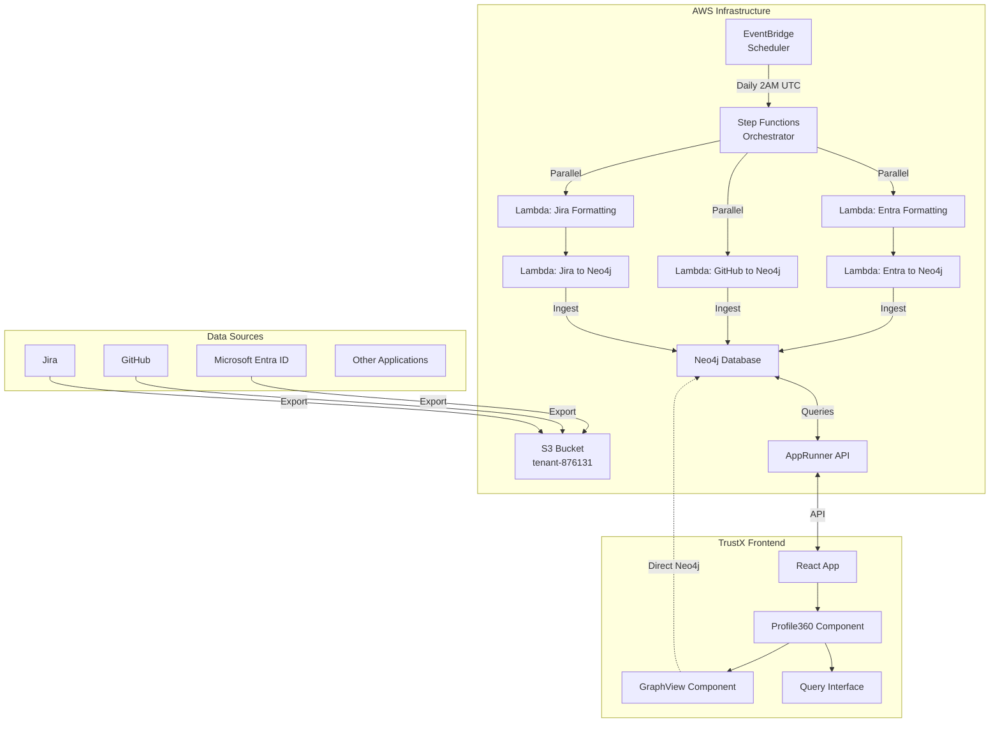
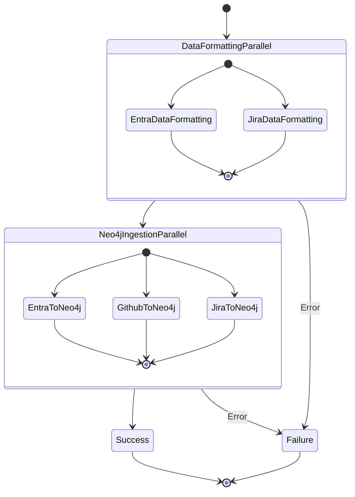

# Profile360-architecture-guide

[[Project Library]] · [[Career Library]]

Source documentation from an external project snapshot. It does not independently establish personal authorship, current deployment, or measured outcomes.

# Profile 360 Architecture Guide

## Overview

Profile 360 is a comprehensive identity and access management visualization system that aggregates user data from multiple enterprise applications and presents it through an interactive graph interface. The system uses AWS Step Functions to orchestrate data ingestion pipelines that run on a scheduled basis.

## Architecture Components

### 1. Data Sources
- **Microsoft Entra ID**: User identity data, roles, licenses, organizational structure
- **GitHub**: Developer profiles, repository access, collaboration data
- **Jira**: Project assignments, roles, issue tracking data
- **Other Applications**: Additional enterprise applications

### 2. AWS Infrastructure

#### Storage Layer
- **S3 Bucket**: `tenant-876131` - Stores raw data exports from source systems
- **Neo4j Database**: `52ed4289.databases.neo4j.io` - Graph database for unified data model

#### Processing Layer
- **Lambda Functions**: Individual data processors for each source system
- **Step Functions**: Orchestrates the data pipeline execution
- **EventBridge**: Schedules automated pipeline runs

#### API Layer
- **AppRunner**: Flask-based API for query processing and natural language interface

### 3. Frontend Layer
- **React Application**: TrustX frontend with Profile360 visualization
- **Interactive Graph**: Force-directed graph using react-force-graph-2d
- **Query Interface**: Natural language and Cypher query support

## Data Flow Architecture



## Step Functions Workflow

### Pipeline Overview
The Profile360 Step Functions state machine orchestrates the data processing pipeline with the following stages:



### Execution Stages

1. **Data Formatting Stage** (Parallel Execution)
   - **Entra ID Data Formatting**: Transforms raw Entra ID exports into standardized JSON
   - **Jira Data Formatting**: Processes Jira project and user data exports

2. **Neo4j Ingestion Stage** (Parallel Execution)
   - **Entra ID to Neo4j**: Creates User, Company, Role, and ServicePlan nodes
   - **GitHub to Neo4j**: Ingests developer profile and repository data
   - **Jira to Neo4j**: Creates project resources and user role relationships

3. **Success/Failure Handling**
   - **Success State**: Pipeline completed successfully
   - **Failure State**: Error handling with detailed error information

### Scheduling Configuration
- **Frequency**: Daily execution at 2:00 AM UTC
- **Trigger**: EventBridge scheduled rule `{environment}-profile360-daily-sync`
- **Timeout**: 2 hours maximum execution time
- **Error Handling**: Automatic retries with exponential backoff
- **Input Parameters**: Environment context and timestamp

### State Machine Configuration
```json
{
  "source": "eventbridge-scheduled",
  "timestamp": "2024-01-15T02:00:00Z",
  "environment": "production"
}
```

## Lambda Functions

### 1. Entra Data Formatting Lambda
- **Function**: `{environment}-entra-data-formatting`
- **Purpose**: Transforms raw Entra ID data into standardized format
- **Runtime**: Python 3.11
- **Timeout**: 30 seconds
- **Memory**: 256 MB

### 2. Entra to Neo4j Lambda
- **Function**: `{environment}-entra-to-neo4j`
- **Purpose**: Ingests formatted Entra ID data into Neo4j
- **Creates**: User, Company, Location, Role, ServicePlan nodes
- **Relationships**: BELONGS_TO, USES_APPLICATION, HAS_ROLE, REPORTS_TO

### 3. GitHub to Neo4j Lambda
- **Function**: `{environment}-github-to-neo4j`
- **Purpose**: Ingests GitHub user data into Neo4j
- **Creates**: User nodes with GitHub profile information
- **Relationships**: USES_APPLICATION (GitHub)

### 4. Jira Data Formatting Lambda
- **Function**: `{environment}-jira-data-formatting`
- **Purpose**: Transforms raw Jira data into standardized format
- **Runtime**: Python 3.11
- **Timeout**: 30 seconds
- **Memory**: 256 MB

### 5. Jira to Neo4j Lambda
- **Function**: `{environment}-jira-to-neo4j`
- **Purpose**: Ingests Jira project and user data into Neo4j
- **Creates**: User, Resource (projects), Role nodes
- **Relationships**: HAS_ROLE, ROLE_FOR, ENGAGED_WITH

## Neo4j Data Model

### Node Types
- **User**: Individual users across all systems
- **Company**: Organizations/companies
- **Application**: Software applications (Entra ID, GitHub, Jira)
- **Role**: User roles within applications
- **Resource**: Projects, repositories, or other resources
- **Location**: Geographic locations
- **ServicePlan**: Subscription plans or licenses

### Relationship Types
- **BELONGS_TO**: User belongs to Company
- **USES_APPLICATION**: User uses Application
- **HAS_ROLE**: User has Role
- **ROLE_FOR**: Role applies to Resource
- **REPORTS_TO**: User reports to another User
- **RESIDES_IN**: User resides in Location
- **SUBSCRIBED_TO**: User subscribed to ServicePlan
- **ENGAGED_WITH**: Resource engaged with Role

## Frontend Components

### Navigation
- **Route**: `/Access` in TrustX application
- **Label**: "Profile360" in left navigation menu
- **Icon**: Chart bar icon

### Main Components

#### Neo4jVisualizer
- **Purpose**: Main container component for Profile360
- **Features**: Query execution, data visualization, table results
- **Direct Neo4j Connection**: Bypasses API for real-time queries

#### GraphView
- **Purpose**: Interactive force-directed graph visualization
- **Features**: Node clustering, filtering, click interactions
- **Libraries**: react-force-graph-2d, d3-force

#### QueryBar
- **Purpose**: Natural language query interface
- **Features**: Text input, Enter key execution, loading states
- **Integration**: Connects to AppRunner API for query processing

#### SampleQueriesComponent
- **Purpose**: Pre-defined query buttons for common use cases
- **Features**: Quick access to frequent queries
- **Examples**: User access summaries, role distributions

## Deployment

### Prerequisites
- AWS CDK CLI installed
- Node.js (v14 or later)
- AWS CLI configured with appropriate credentials
- TypeScript installed globally

### Deploy Profile360 Stack
```bash
# Deploy only Profile360 stack
cdk deploy {environment}-profile360-stack

# Deploy all stacks
cdk deploy --all
```

### Environment Variables
- `SECRET_ARN`: Database secret ARN
- `ENVIRONMENT`: Deployment environment (dev, stg, prod)
- `AUTH0_DOMAIN`: Auth0 domain for authentication
- `AUTH0_AUDIENCE`: Auth0 audience for API access

## Monitoring and Observability

### CloudWatch Metrics
- Step Functions execution metrics
- Lambda function performance metrics
- Error rates and failure notifications

### Logging
- Structured logging in all Lambda functions
- Step Functions execution history
- Neo4j query performance logs

### Alerts
- Pipeline failure notifications
- Lambda timeout alerts
- Neo4j connection issues

## Security

### IAM Roles
- **Step Functions Role**: Permissions to invoke Lambda functions
- **Lambda Execution Role**: VPC access, Secrets Manager, S3 permissions
- **EventBridge Role**: Permissions to execute Step Functions

### Network Security
- Lambda functions deployed in private subnets
- Security groups restrict network access
- VPC endpoints for AWS services

### Data Security
- Secrets Manager for database credentials
- Encrypted S3 storage
- TLS encryption for Neo4j connections

## Troubleshooting

### Common Issues

#### Pipeline Failures
1. Check Step Functions execution history
2. Review Lambda function logs in CloudWatch
3. Verify S3 data availability
4. Check Neo4j connectivity

#### Frontend Issues
1. Verify Neo4j connection credentials
2. Check CORS configuration
3. Review browser console for JavaScript errors
4. Validate API endpoint configuration

#### Performance Issues
1. Monitor Lambda memory usage
2. Check Neo4j query performance
3. Review graph rendering performance
4. Optimize data clustering thresholds

### Support Contacts
- **Infrastructure**: AWS CDK team
- **Frontend**: React development team
- **Data Pipeline**: Lambda development team
- **Database**: Neo4j administration team

## API Endpoints

### AppRunner API
- **Base URL**: Configured via `REACT_APP_API_URL` environment variable
- **Health Check**: `GET /health` - Returns service status
- **Query Processing**: `POST /query` - Processes natural language queries

### Query Endpoint Details
```javascript
// Request format
{
  "query": "Show me all users in the Engineering department"
}

// Response format
{
  "cypher_query": "MATCH (u:User {department: 'Engineering'}) RETURN u",
  "results": [...],
  "execution_time": 0.45
}
```

### Direct Neo4j Connection
Frontend components can bypass the API for real-time queries:
```javascript
const driver = neo4j.driver(
  'neo4j+s://52ed4289.databases.neo4j.io',
  neo4j.auth.basic('neo4j', 'password')
);
```

## Data Processing Details

### S3 Data Structure
```
tenant-876131/
├── applications/
│   ├── EntraID/
│   │   └── {tenant-id}/
│   │       └── {date-folder}/
│   │           └── ConsolidatedUsers.json
│   ├── GitHub/
│   │   └── {org-id}/
│   │       └── {date-folder}/
│   │           └── users.json
│   └── Jira/
│       └── {instance-id}/
│           └── {date-folder}/
│               └── projects_users.json
```

### Lambda Function Specifications

#### Memory and Timeout Configuration
| Function | Memory (MB) | Timeout (sec) | Concurrent Executions |
|----------|-------------|---------------|----------------------|
| Entra Data Formatting | 256 | 30 | 10 |
| Entra to Neo4j | 256 | 30 | 10 |
| GitHub to Neo4j | 256 | 30 | 10 |
| Jira Data Formatting | 256 | 30 | 10 |
| Jira to Neo4j | 256 | 30 | 10 |

#### Environment Variables
```bash
SECRET_ARN=arn:aws:secretsmanager:region:account:secret:name
ENVIRONMENT=production
AUTH0_DOMAIN=your-domain.auth0.com
AUTH0_AUDIENCE=your-api-audience
NEO4J_URI=neo4j+s://52ed4289.databases.neo4j.io
S3_BUCKET=tenant-876131
```

## Performance Optimization

### Graph Visualization
- **Node Clustering**: Automatically clusters nodes when count exceeds 20
- **Lazy Loading**: Loads graph data on demand
- **Filtering**: Real-time filtering by node type and properties
- **Caching**: Browser-side caching of query results

### Database Optimization
- **Indexing**: Indexes on email, name, and ID fields
- **Query Optimization**: Optimized Cypher queries for common patterns
- **Connection Pooling**: Managed connection pools for high availability

### Frontend Performance
- **Code Splitting**: Lazy loading of Profile360 components
- **Memoization**: React.memo for expensive graph calculations
- **Debouncing**: Query input debouncing to reduce API calls

## Operational Procedures

### Manual Pipeline Execution
```bash
# Execute Step Functions manually
aws stepfunctions start-execution \
  --state-machine-arn arn:aws:states:region:account:stateMachine:profile360-pipeline \
  --input '{"source": "manual", "environment": "production"}'
```

### Data Validation
1. **Pre-processing Validation**: Check S3 data completeness
2. **Post-processing Validation**: Verify Neo4j node counts
3. **Relationship Validation**: Ensure relationship integrity

### Backup and Recovery
- **Neo4j Backups**: Daily automated backups
- **S3 Versioning**: Enabled for data recovery
- **State Machine History**: 90-day execution history retention

### Scaling Considerations
- **Lambda Concurrency**: Adjust reserved concurrency based on data volume
- **Neo4j Resources**: Monitor memory and CPU usage
- **Frontend Caching**: Implement Redis for query result caching

## Cost Optimization

### AWS Services Cost Breakdown
- **Lambda**: Pay-per-execution model
- **Step Functions**: State transition pricing
- **S3**: Storage and request costs
- **EventBridge**: Rule evaluation costs
- **AppRunner**: vCPU and memory pricing

### Cost Monitoring
- **CloudWatch Dashboards**: Real-time cost tracking
- **Budget Alerts**: Monthly cost threshold alerts
- **Resource Tagging**: Detailed cost allocation

## Compliance and Governance

### Data Privacy
- **GDPR Compliance**: User data anonymization options
- **Data Retention**: Configurable retention policies
- **Access Controls**: Role-based access to sensitive data

### Audit Trail
- **CloudTrail**: API call logging
- **Step Functions Logs**: Execution audit trail
- **Neo4j Audit**: Query execution logging

### Change Management
- **Infrastructure as Code**: All resources defined in CDK
- **Version Control**: Git-based change tracking
- **Deployment Pipeline**: Automated testing and deployment


## Source provenance

[External original](file:///D:/HDD%20F/downloads/CV/Previous%20Exp%20%2B%20Interview%20Prep/Samay%20%2B%20Trustx%20experience/TrustxRepos/AWS/docs/profile360-architecture-guide.md) · Samay + Trustx experience/TrustxRepos/AWS/docs/profile360-architecture-guide.md

Project code and dependencies remain outside the vault. No source commands were executed.
