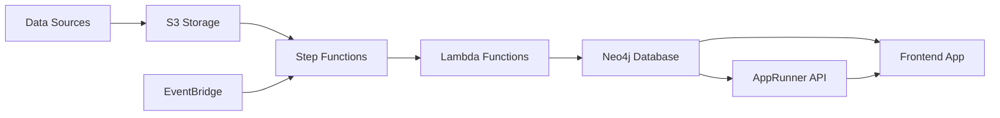

# Profile360-system-overview

[[Project Library]] · [[Career Library]]

Source documentation from an external project snapshot. It does not independently establish personal authorship, current deployment, or measured outcomes.

# Profile 360 System Overview

## Executive Summary

Profile 360 is an enterprise identity and access management visualization platform that provides comprehensive insights into user access patterns across multiple applications. The system aggregates data from Microsoft Entra ID, GitHub, Jira, and other enterprise applications, processes it through automated pipelines, and presents it via an interactive graph-based interface.

## Key Features

### 🔄 Automated Data Pipeline
- **Scheduled Execution**: Daily automated data ingestion at 2 AM UTC
- **Multi-Source Integration**: Entra ID, GitHub, Jira, and extensible for additional sources
- **Parallel Processing**: Optimized pipeline with concurrent data processing
- **Error Handling**: Robust retry mechanisms and failure notifications

### 📊 Interactive Visualization
- **Graph-Based Interface**: Force-directed graph showing relationships between users, applications, and resources
- **Natural Language Queries**: AI-powered query interface for non-technical users
- **Real-Time Filtering**: Dynamic filtering by user attributes, roles, and applications
- **Node Clustering**: Automatic clustering for large datasets with drill-down capabilities

### 🔍 Comprehensive Analytics
- **User Access Summary**: Complete view of user permissions across all systems
- **Risk Assessment**: AI-powered insights for identifying potential security risks
- **Compliance Reporting**: Automated compliance checks and audit trails
- **Relationship Mapping**: Visual representation of organizational hierarchies and access patterns

## System Architecture

### Data Flow Overview



### Core Components

#### 1. Data Ingestion Layer
- **S3 Bucket**: Centralized storage for raw data exports
- **Lambda Functions**: Individual processors for each data source
- **Step Functions**: Orchestration engine for automated pipeline execution
- **EventBridge**: Scheduling service for regular data updates

#### 2. Data Storage Layer
- **Neo4j Graph Database**: Unified data model with rich relationships
- **Node Types**: Users, Companies, Applications, Roles, Resources, Locations
- **Relationships**: BELONGS_TO, USES_APPLICATION, HAS_ROLE, REPORTS_TO, etc.

#### 3. API Layer
- **AppRunner Service**: Flask-based API for query processing
- **Natural Language Processing**: Converts user queries to Cypher queries
- **Direct Neo4j Access**: Frontend can query database directly for real-time updates

#### 4. Frontend Layer
- **React Application**: Modern web interface with responsive design
- **Interactive Graph**: Force-directed visualization using react-force-graph-2d
- **Query Interface**: Both natural language and advanced query options
- **Dashboard Components**: Summary cards, filters, and analytics panels

## Data Sources and Integration

### Microsoft Entra ID
- **User Profiles**: Names, emails, job titles, departments
- **Organizational Structure**: Manager relationships, company affiliations
- **Licenses and Roles**: Service plans, directory roles, permissions
- **Location Data**: Office locations, usage locations

### GitHub
- **Developer Profiles**: GitHub usernames, avatar URLs, profile information
- **Repository Access**: Organization memberships, repository permissions
- **Collaboration Data**: Contribution patterns, team memberships

### Jira
- **Project Assignments**: User roles within projects
- **Issue Tracking**: Assignee relationships, project participation
- **Workflow Permissions**: Role-based access to project resources

### Extensibility
The system is designed to easily accommodate additional data sources:
- **Standardized Data Format**: Common JSON schema for all sources
- **Modular Lambda Functions**: Template-based approach for new integrations
- **Flexible Data Model**: Neo4j schema can accommodate new node and relationship types

## Deployment Architecture

### AWS Infrastructure
- **Region**: us-east-2 (Ohio)
- **VPC**: Private subnets for Lambda functions
- **Security Groups**: Restricted network access
- **IAM Roles**: Least-privilege access policies

### Environment Configuration
- **Development**: `dev-profile360-stack`
- **Staging**: `stg-profile360-stack`
- **Production**: `prod-profile360-stack`

### Monitoring and Observability
- **CloudWatch Metrics**: Pipeline execution metrics, error rates
- **CloudWatch Logs**: Structured logging from all components
- **Step Functions Console**: Visual pipeline monitoring
- **Custom Dashboards**: Business metrics and KPIs

## Security and Compliance

### Data Security
- **Encryption at Rest**: S3 and database encryption
- **Encryption in Transit**: TLS for all communications
- **Access Controls**: IAM roles and policies
- **Secrets Management**: AWS Secrets Manager for credentials

### Privacy and Compliance
- **Data Minimization**: Only necessary user data is collected
- **Retention Policies**: Configurable data retention periods
- **Audit Trails**: Complete logging of all data access
- **GDPR Compliance**: User data anonymization capabilities

### Network Security
- **VPC Isolation**: Lambda functions in private subnets
- **Security Groups**: Restrictive inbound/outbound rules
- **VPC Endpoints**: Secure access to AWS services
- **WAF Protection**: Web application firewall for frontend

## Performance and Scalability

### Current Capacity
- **Users**: Supports up to 10,000 users per organization
- **Data Volume**: Processes ~1GB of raw data per execution
- **Query Performance**: Sub-second response times for most queries
- **Concurrent Users**: Supports 100+ simultaneous frontend users

### Scalability Features
- **Horizontal Scaling**: Lambda functions scale automatically
- **Database Optimization**: Indexed queries and connection pooling
- **Frontend Caching**: Browser and CDN caching strategies
- **Parallel Processing**: Step Functions enable concurrent execution

### Performance Optimization
- **Graph Clustering**: Reduces rendering complexity for large datasets
- **Lazy Loading**: On-demand data loading in frontend
- **Query Optimization**: Efficient Cypher queries with proper indexing
- **Caching Strategies**: Multi-layer caching for frequently accessed data

## Cost Structure

### Monthly Operating Costs (Production)
- **Lambda Functions**: ~$50/month (based on daily execution)
- **Step Functions**: ~$1/month (state transitions)
- **S3 Storage**: ~$10/month (data storage and requests)
- **Neo4j Database**: ~$200/month (managed service)
- **AppRunner**: ~$100/month (API service)
- **EventBridge**: <$1/month (scheduled rules)
- **Total**: ~$361/month

### Cost Optimization Strategies
- **Reserved Capacity**: Neo4j reserved instances for predictable workloads
- **S3 Lifecycle Policies**: Automatic archival of old data
- **Lambda Optimization**: Right-sizing memory and timeout settings
- **Monitoring**: Cost alerts and budget controls

## Getting Started

### Prerequisites
- AWS Account with appropriate permissions
- Node.js 14+ and AWS CDK CLI
- Access to data sources (Entra ID, GitHub, Jira)
- Neo4j database instance

### Quick Deployment
```bash
# Clone repository
git clone <repository-url>
cd AWS

# Install dependencies
npm install

# Configure environment
export AWS_PROFILE=your-profile
export CDK_DEFAULT_REGION=us-east-2

# Deploy infrastructure
cdk deploy prod-profile360-stack
```

### Initial Data Setup
1. **Configure Data Sources**: Set up API access for Entra ID, GitHub, Jira
2. **Upload Sample Data**: Place initial data exports in S3
3. **Run Pipeline**: Execute Step Functions manually for first run
4. **Verify Data**: Check Neo4j database for imported data
5. **Access Frontend**: Navigate to TrustX application `/Access` route

## Support and Maintenance

### Documentation
- **Architecture Guide**: Detailed technical documentation
- **Deployment Guide**: Step-by-step deployment instructions
- **User Manual**: Frontend usage and query examples
- **API Reference**: Complete API documentation

### Monitoring and Alerts
- **Pipeline Failures**: Automatic notifications for failed executions
- **Performance Degradation**: Alerts for slow query performance
- **Cost Overruns**: Budget alerts for unexpected cost increases
- **Security Events**: Notifications for unauthorized access attempts

### Maintenance Schedule
- **Daily**: Automated data pipeline execution
- **Weekly**: Performance metrics review
- **Monthly**: Cost analysis and optimization
- **Quarterly**: Security audit and compliance review

## Roadmap and Future Enhancements

### Short Term (Next 3 months)
- **Additional Data Sources**: Slack, Microsoft Teams integration
- **Enhanced Analytics**: Advanced risk scoring algorithms
- **Mobile Interface**: Responsive design improvements
- **Performance Optimization**: Query caching and indexing improvements

### Medium Term (3-6 months)
- **Machine Learning**: Anomaly detection for unusual access patterns
- **Advanced Visualizations**: Timeline views, heat maps
- **API Enhancements**: GraphQL API for flexible queries
- **Multi-Tenant Support**: Organization isolation and management

### Long Term (6+ months)
- **Real-Time Updates**: Streaming data ingestion
- **Advanced AI**: Natural language query improvements
- **Integration Platform**: Marketplace for third-party connectors
- **Enterprise Features**: Advanced compliance and governance tools

## Contact Information

### Technical Support
- **Infrastructure**: AWS CDK Team
- **Frontend**: React Development Team  
- **Data Pipeline**: Lambda Development Team
- **Database**: Neo4j Administration Team

### Business Contacts
- **Product Owner**: Profile 360 Product Team
- **Security**: Information Security Team
- **Compliance**: Compliance and Risk Team


## Source provenance

[External original](file:///D:/HDD%20F/downloads/CV/Previous%20Exp%20%2B%20Interview%20Prep/Samay%20%2B%20Trustx%20experience/TrustxRepos/AWS/docs/profile360-system-overview.md) · Samay + Trustx experience/TrustxRepos/AWS/docs/profile360-system-overview.md

Project code and dependencies remain outside the vault. No source commands were executed.
