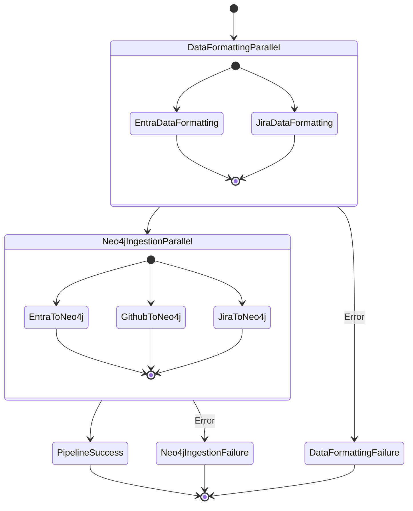

# Step Functions Overview

[[Project Library]] · [[Career Library]]

Source documentation from an external project snapshot. It does not independently establish personal authorship, current deployment, or measured outcomes.

# Profile 360 Step Functions Workflow

This directory contains the Step Functions workflow definition for the Profile 360 data pipeline, organized as code alongside the Lambda functions.

## Files

### `profile360-pipeline.json`
The main Step Functions workflow definition in Amazon States Language (ASL) format. This file defines:

- **Data Formatting Stage**: Parallel execution of Entra ID and Jira data formatting
- **Neo4j Ingestion Stage**: Parallel execution of all data source ingestion
- **Error Handling**: Retry logic and failure states
- **Success/Failure States**: Terminal states for pipeline completion

### `workflow-loader.ts`
TypeScript utility class for loading and processing the workflow definition:

- Loads the JSON workflow definition
- Replaces Lambda ARN placeholders with actual function ARNs
- Validates workflow structure
- Provides helper functions for CDK integration

### `README.md`
This documentation file.

## Workflow Structure



## Usage in CDK

### Basic Usage

```typescript
import { Profile360WorkflowLoader, createLambdaArnMappings } from './src/profile-360/StepFunctions/workflow-loader';

// In your CDK stack
const lambdaArns = createLambdaArnMappings({
  entraDataFormattingLambda: this.entraDataFormattingLambda,
  entraToNeo4jLambda: this.entraToNeo4jLambda,
  githubToNeo4jLambda: this.githubToNeo4jLambda,
  jiraDataFormattingLambda: this.jiraDataFormattingLambda,
  jiraToNeo4jLambda: this.jiraToNeo4jLambda,
});

// Load the workflow definition
const workflowDefinition = Profile360WorkflowLoader.loadWorkflowDefinition(lambdaArns);

// Create the state machine
const stateMachine = new stepfunctions.StateMachine(this, 'Profile360StateMachine', {
  definition: stepfunctions.DefinitionBody.fromString(JSON.stringify(workflowDefinition)),
  // ... other properties
});
```

### Advanced Usage

```typescript
// Validate workflow before creating state machine
try {
  const workflowDefinition = Profile360WorkflowLoader.loadWorkflowDefinition(lambdaArns);
  Profile360WorkflowLoader.validateWorkflowDefinition(workflowDefinition);
  
  // Create state machine with validated definition
  const stateMachine = new stepfunctions.StateMachine(this, 'Profile360StateMachine', {
    definition: stepfunctions.DefinitionBody.fromString(JSON.stringify(workflowDefinition)),
    stateMachineName: `${envConfig.environment}-profile360-pipeline`,
    role: stepFunctionsRole,
    timeout: cdk.Duration.hours(2),
  });
} catch (error) {
  console.error('Workflow validation failed:', error);
  throw error;
}
```

## Lambda ARN Placeholders

The workflow definition uses placeholders for Lambda function ARNs that are replaced at deployment time:

- `${EntraDataFormattingLambdaArn}` → Entra ID data formatting Lambda ARN
- `${EntraToNeo4jLambdaArn}` → Entra ID to Neo4j Lambda ARN
- `${GithubToNeo4jLambdaArn}` → GitHub to Neo4j Lambda ARN
- `${JiraDataFormattingLambdaArn}` → Jira data formatting Lambda ARN
- `${JiraToNeo4jLambdaArn}` → Jira to Neo4j Lambda ARN

## Error Handling

### Retry Configuration
Each Lambda task includes retry logic for common AWS service exceptions:

```json
{
  "Retry": [
    {
      "ErrorEquals": [
        "Lambda.ServiceException",
        "Lambda.AWSLambdaException",
        "Lambda.SdkClientException",
        "Lambda.TooManyRequestsException"
      ],
      "IntervalSeconds": 2,
      "MaxAttempts": 3,
      "BackoffRate": 2.0
    }
  ]
}
```

### Catch Configuration
Each parallel stage includes catch blocks to handle failures:

```json
{
  "Catch": [
    {
      "ErrorEquals": ["States.ALL"],
      "Next": "DataFormattingFailure",
      "Comment": "Catch any errors in data formatting stage"
    }
  ]
}
```

## Modifying the Workflow

### Adding a New Lambda Function

1. **Update the JSON definition** (`profile360-pipeline.json`):
   ```json
   {
     "StartAt": "NewLambdaTask",
     "States": {
       "NewLambdaTask": {
         "Type": "Task",
         "Resource": "arn:aws:states:::lambda:invoke",
         "Parameters": {
           "FunctionName": "${NewLambdaArn}",
           "Payload.$": "$"
         },
         "OutputPath": "$.Payload",
         "Retry": [...],
         "End": true
       }
     }
   }
   ```

2. **Update the TypeScript interfaces** (`workflow-loader.ts`):
   ```typescript
   export interface LambdaArnMappings {
     // ... existing mappings
     NewLambdaArn: string;
   }
   ```

3. **Update the CDK stack** to include the new Lambda function in the mappings.

### Changing Retry Logic

Modify the retry configuration in the JSON file:

```json
{
  "Retry": [
    {
      "ErrorEquals": ["States.TaskFailed"],
      "IntervalSeconds": 5,
      "MaxAttempts": 5,
      "BackoffRate": 2.0
    }
  ]
}
```

### Adding New Parallel Branches

Add new branches to existing parallel states:

```json
{
  "Type": "Parallel",
  "Branches": [
    // ... existing branches
    {
      "StartAt": "NewBranchTask",
      "States": {
        "NewBranchTask": {
          // ... task definition
        }
      }
    }
  ]
}
```

## Testing

### Local Validation

```typescript
// Test workflow loading
const lambdaArns = {
  EntraDataFormattingLambdaArn: 'arn:aws:lambda:us-east-2:123456789012:function:test-entra-formatting',
  // ... other ARNs
};

try {
  const workflow = Profile360WorkflowLoader.loadWorkflowDefinition(lambdaArns);
  console.log('Workflow loaded successfully');
  
  Profile360WorkflowLoader.validateWorkflowDefinition(workflow);
  console.log('Workflow validation passed');
} catch (error) {
  console.error('Workflow test failed:', error);
}
```

### Extract Placeholders

```typescript
// Get all Lambda placeholders used in the workflow
const placeholders = Profile360WorkflowLoader.extractLambdaPlaceholders();
console.log('Required Lambda ARNs:', placeholders);
```

## Best Practices

### 1. Version Control
- Keep the JSON workflow definition in version control
- Use meaningful commit messages when modifying the workflow
- Tag releases for production deployments

### 2. Validation
- Always validate the workflow definition before deployment
- Test with sample Lambda ARNs in development
- Use the TypeScript loader to catch errors early

### 3. Documentation
- Update this README when modifying the workflow
- Document any custom error handling or retry logic
- Include examples for common modifications

### 4. Monitoring
- Use CloudWatch to monitor workflow executions
- Set up alarms for failed executions
- Review execution history regularly

## Troubleshooting

### Common Issues

#### 1. Invalid JSON Syntax
```
Error: Invalid JSON in workflow definition: Unexpected token...
```
**Solution**: Validate JSON syntax using a JSON validator or IDE.

#### 2. Unresolved Placeholders
```
Error: Unresolved placeholders in workflow definition: ${SomeLambdaArn}
```
**Solution**: Ensure all Lambda ARN mappings are provided and correctly named.

#### 3. Missing Required Properties
```
Error: Missing required property in workflow definition: StartAt
```
**Solution**: Verify the workflow definition includes all required ASL properties.

#### 4. State Not Found
```
Error: StartAt state 'InvalidState' not found in States
```
**Solution**: Ensure the StartAt state name matches an existing state in the States object.

### Debugging

1. **Enable verbose logging** in the workflow loader
2. **Use the raw workflow definition** function to see the processed JSON
3. **Validate against AWS ASL specification**
4. **Test with minimal workflow** to isolate issues

## References

- [Amazon States Language Specification](https://states-language.net/spec.html)
- [AWS Step Functions Developer Guide](https://docs.aws.amazon.com/step-functions/latest/dg/)
- [AWS CDK Step Functions Module](https://docs.aws.amazon.com/cdk/api/v2/docs/aws-cdk-lib.aws_stepfunctions-readme.html)


## Source provenance

[External original](file:///D:/HDD%20F/downloads/CV/Previous%20Exp%20%2B%20Interview%20Prep/Samay%20%2B%20Trustx%20experience/TrustxRepos/AWS/src/profile-360/StepFunctions/README.md) · Samay + Trustx experience/TrustxRepos/AWS/src/profile-360/StepFunctions/README.md

Project code and dependencies remain outside the vault. No source commands were executed.
